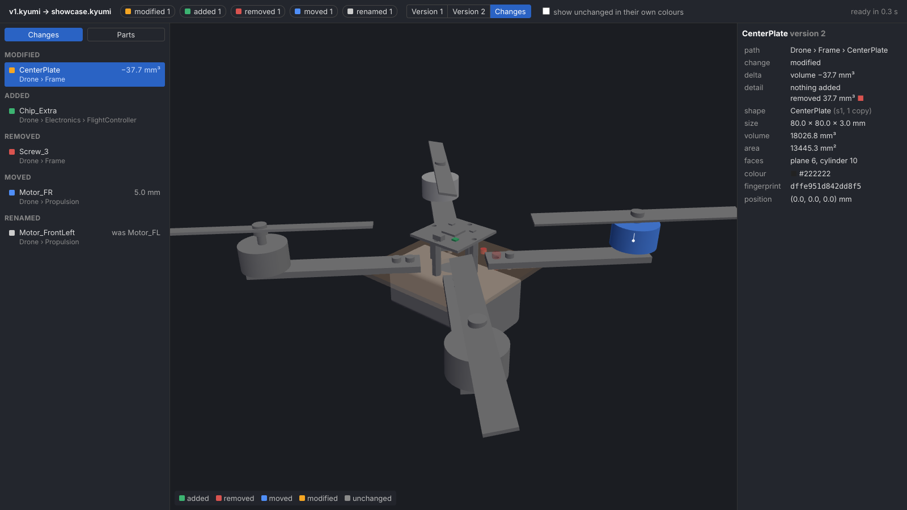
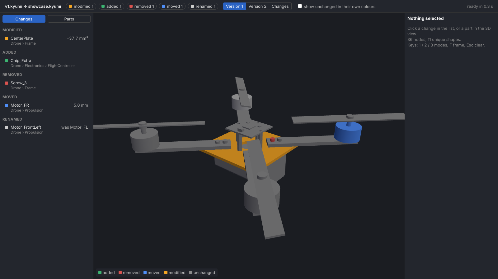
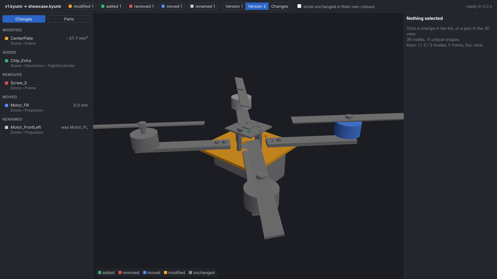
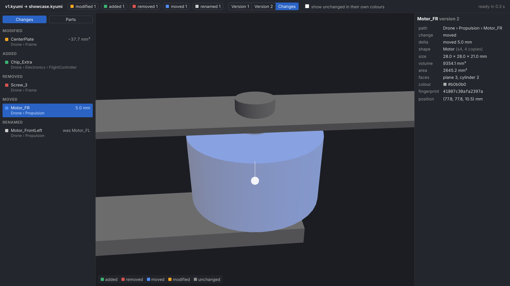

# cad-tools

A trial of two features for Kyumi ("GitHub for engineers"): **DIFF** — compare
two versions of a 3D CAD assembly and say what was added, removed, moved,
renamed or modified — and **CATEGORIZE** — sort the parts of a model into
categories automatically instead of by hand. Diff is built and measured on a real 316-part model;
categorize is planned ([docs/categorize-plan.md](docs/categorize-plan.md)).
`core/` (a STEP importer and a small viewer) is scaffolding so there is
something runnable here: Kyumi has its own loader and viewer, and the diff talks
to them only through one small API (see [What Kyumi would reuse](#what-kyumi-would-reuse)).



## Try it in 5 minutes

You need Python 3.11 or newer (tested on 3.11 and 3.13; check with
`py --version` on Windows, `python3 --version` on Mac) and `git`. Everything
below runs offline except the first `pip install` and the viewer's three.js
download.

Windows (Command Prompt; if `py` is not found, use `python` instead):

```bat
git clone https://github.com/nex0517/cad-tools.git && cd cad-tools
py -m venv .venv && .venv\Scripts\activate
pip install -e core -e diff
kyumi import fixtures\pairs\drone\v1.step -o v1.kyumi
kyumi import fixtures\pairs\drone\showcase.step -o showcase.kyumi
kyumi diff v1.kyumi showcase.kyumi --detail-all --out-dir showcase-detail
kyumi view v1.kyumi showcase.kyumi --detail showcase-detail
```

Mac / Linux:

```sh
git clone https://github.com/nex0517/cad-tools.git && cd cad-tools
python3 -m venv .venv && source .venv/bin/activate
pip install -e core -e diff
kyumi import fixtures/pairs/drone/v1.step -o v1.kyumi
kyumi import fixtures/pairs/drone/showcase.step -o showcase.kyumi
kyumi diff v1.kyumi showcase.kyumi --detail-all --out-dir showcase-detail
kyumi view v1.kyumi showcase.kyumi --detail showcase-detail
```

What each line does: `import` turns a STEP file into a `.kyumi` package (the
tree, measurements, a mesh and the exact geometry of every part). `diff
--detail-all` compares the two packages, prints the changes, and computes the
exact added / removed material of every modified part ahead of time. `view`
opens the browser on the diff (Ctrl+C in the terminal stops it).

The showcase pair is the drone from `v1.step` with exactly one change of each
kind: a chip added, a screw removed, a motor moved 5 mm, a motor renamed and a
4 mm hole drilled through the centre plate. `kyumi diff` should print:

```
added 1  removed 1  moved 1  renamed 1  modified 1  re-parented 0
modified  Drone › Frame › CenterPlate  volume -37.7 mm³
renamed  Drone › Propulsion › Motor_FL  →  Drone › Propulsion › Motor_FrontLeft
moved  Drone › Propulsion › Motor_FR  by 5.0 mm
added  Drone › Electronics › FlightController › Chip_Extra
removed  Drone › Frame › Screw_3
```

## What you're looking at

- **Colours.** Added green, removed red, moved blue (with a white line from the
  old centre to the new one), modified orange. A renamed part keeps its own
  colour and gets a `renamed` tag. Unchanged parts are grey until "show
  unchanged" is ticked.
- **Three modes** (top bar, or keys `1` / `2` / `3`). *Changes* is the new
  model plus red see-through ghosts where parts were removed. *Version 1* and
  *Version 2* each show one version alone, with the same colours, so you can
  flick between them like two photos. The camera and the selection stay put.
- **Change list** (left): one row per change, grouped by kind, with the part's
  name, where it sits and the size of the change (`5.0 mm`, `−736.2 mm³`).
  Click a row and the camera flies to the part; click a chip in the top bar to
  filter the list to one kind. The *Parts* tab is the plain assembly tree.
- **Exact detail.** Select the modified part in *Changes*: it turns see-through and the
  material that was removed is drawn in solid red (added material in green),
  computed from the exact B-rep geometry, not from the meshes.

| Version 1 | Version 2 | Change list |
|---|---|---|
|  |  |  |

## How it works

- Every part gets a **fingerprint** from its exact geometry (volume, area,
  size, moments of inertia, face counts, rounded to four digits), so two copies
  of a part are recognised as the same shape wherever they sit.
- **Matching** pairs up each old part with its new self; among parts with the
  same fingerprint, **position beats name**: a part that kept its place is the
  same part even if it was renamed, and a part that moved is the same part
  because nothing else sits where it was.
- Parts are reported by **stable keys** (`Drone / Frame / CenterPlate`, with
  `#2` for the second same-named sibling), never by file-internal ids, which
  change with every export.
- The **exact detail** of a modified part is `new − old` and `old − new` on the
  B-rep solids, computed in the part's own frame (so a part that only moved
  shows nothing) and written as meshes next to a small JSON index.
- The **server does the thinking**: it runs the matcher, decides every part's
  status in both versions and serves one `/changes.json`; the page only paints.

Full plan and decisions: [docs/diff-plan.md](docs/diff-plan.md).

## Results on a real 316-part model

Measured on a 316-part, 335-node assembly (CPT17, not committed; details in
[docs/real-files.md](docs/real-files.md)):

- Import: 53 s with exact geometry (12.9 MB package), 36 s without (9.8 MB).
- Diff of two versions: well under a second (`/changes.json` is built in 0.02 s;
  the end-to-end numbers in the table are dominated by reading the packages).
- Every generated pair (no change, rename, move, delete, modify) came out
  exactly as expected.
- Exact detail of a drilled hole: 736.2 mm³ removed, 0.0 added, within 1 % of
  the true volume, in 2.8 s.
- Viewer page ready in 2.4–3.5 s.

Separately, a synthetic 5,000-part model (the drone tiled 162 times, every tile
with the same names) diffs in 0.4 s including loading.

## What Kyumi would reuse

Not the importer or the page. The reusable boundary is:

- `load()` and the `Model` / `Node` / `Shape` API (`core/kyumi/model.py`): the
  diff reads a model only through it — tree, per-parent transforms, names,
  colours, measurements and the exact geometry — so it can be pointed at Kyumi's
  own loader. What exactly it uses is listed in
  [docs/diff-plan.md](docs/diff-plan.md#what-i-need-from-core).
- `/changes.json`: every part's status in both versions, ghosts and moves, in
  one JSON the viewer paints without deciding anything.
- `details.json` + `<id>.added.glb` / `<id>.removed.glb`: the exact detail,
  computed ahead of time, verified against the diff before it is shown.

Both JSON shapes are specified in
[docs/diff-plan.md, section 4](docs/diff-plan.md#4-output).

## Known limits

- Mirror-image twins (a left and a right bracket) share a fingerprint; position
  tells them apart as long as they did not swap places.
- Measurements are rounded to four significant digits, so an edit smaller than
  that rounding reads as "no change".
- Exact detail is expensive on complex surfaces: one 316-part model has a part
  that takes ~30 s on its own, so details are computed ahead with `--detail-all`
  and the viewer never computes them on click.
- Within one version, two parts with the same name, shape and position are
  indistinguishable (they are also indistinguishable to a human).

## What's next

Categorization: sorting parts into fasteners, structure, electronics and so on
from the same measurements and tree, drawn as a flowchart. The plan is in
[docs/categorize-plan.md](docs/categorize-plan.md); nothing is built yet.

## Open questions

Collected in [docs/diff-plan.md](docs/diff-plan.md#open-questions-for-the-startup):
tolerances for "moved", how to report a part that both moved and changed, how to
show a replaced subassembly, and whether comparing two different models is in
scope.

## Decisions

- Kyumi already has its own loader and viewer. `core/` is test scaffolding only:
  it exists so `diff/` and `categorize/` have something to read while they are
  built, and is not meant to ship.
- `diff/` and `categorize/` use only `Model`'s public API (`load()`, the
  `Model`/`Shape`/`Node` dataclasses and `Model`'s helpers), never the `.kyumi` zip
  contents, so they can later be pointed at kyumi's own loader.
- Among parts with the same fingerprint, **position beats name** when matching
  versions (see `docs/diff-plan.md`).
- Diff is not done until it has run on the real v1/v2 pairs in
  `fixtures/real/pairs/` (not committed; `python core/real_files.py` reports on them).
- Developer notes (install with dev tools, tests, module map): `core/README.md`.
